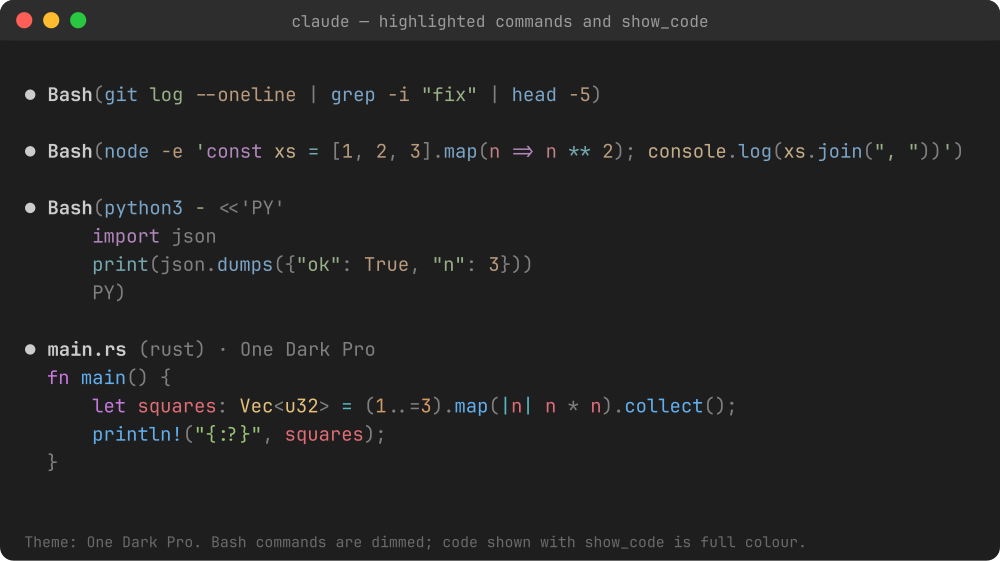

# syntax-cmd

A [Claude Code](https://claude.com/claude-code) mod that syntax-highlights the commands Claude runs, using **your editor's colour theme and TextMate grammars**, and lets Claude show you highlighted code on request.



- **Bash rows** are highlighted but kept dim, like Claude's own grey text (strength is configurable).
- **Code inside commands** is highlighted in its own language, deterministically (no AI): `node -e/-p`, `bun -e/-p`, `deno eval`, `tsx -e`, `python -c`, `ruby -e`, `bash -c`, heredocs (`python3 - <<'EOF'`), here-strings, and `cat > file.py <<EOF` (language from the extension).
- **`show_code` tool**: Claude can display a snippet in any language (`language: "rust"`, `"py"`, `"sql"`...) in full colour.
- **Editors**: VS Code, Cursor, Windsurf, VSCodium, VS Code Insiders (real theme and grammars), plus Zed, Sublime Text, JetBrains, Neovim, Helix and Vim (their theme name is mapped to a bundled equivalent). `editor: auto` picks the IDE Claude Code is connected to, else `$VISUAL`/`$EDITOR`, else the first editor found.

## Install

macOS / Linux / Windows (any shell with `claude` on the PATH):

```sh
claude plugin marketplace add Lucasbk38/claude-syntax-cmd && claude plugin install syntax-cmd@claude-syntax-cmd
```

On Windows PowerShell 5, replace `&&` with `;`. Then restart Claude Code, or run `/reload-plugins`.

Requires `node` on the PATH.

## Configure

In Claude Code: `/config`, then the `syntax-cmd` rows.

| Option | Default | Meaning |
| --- | --- | --- |
| `editor` | `auto` | whose theme and grammars to use |
| `theme` | empty | theme name override (e.g. `One Dark Pro`) |
| `strength` | `0.55` | colour strength of Bash commands (0 grey, 1 full) |
| `codeStrength` | `1` | same for `show_code` output |
| `collapsedLines` | `3` | lines of a long command shown before "ctrl+o to expand" |

## Notes

Bundled TextMate grammars and themes come from [tm-grammars](https://github.com/shikijs/textmate-grammars-themes) and [tm-themes](https://github.com/shikijs/textmate-grammars-themes) (MIT); `vscode-textmate` and `vscode-oniguruma` are vendored (MIT). See `bundled/` and `vendor/` for their licenses. The image is rendered from the tokenizer's real output.
